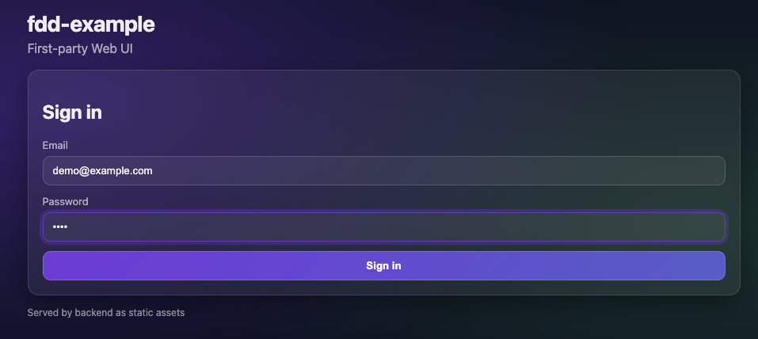
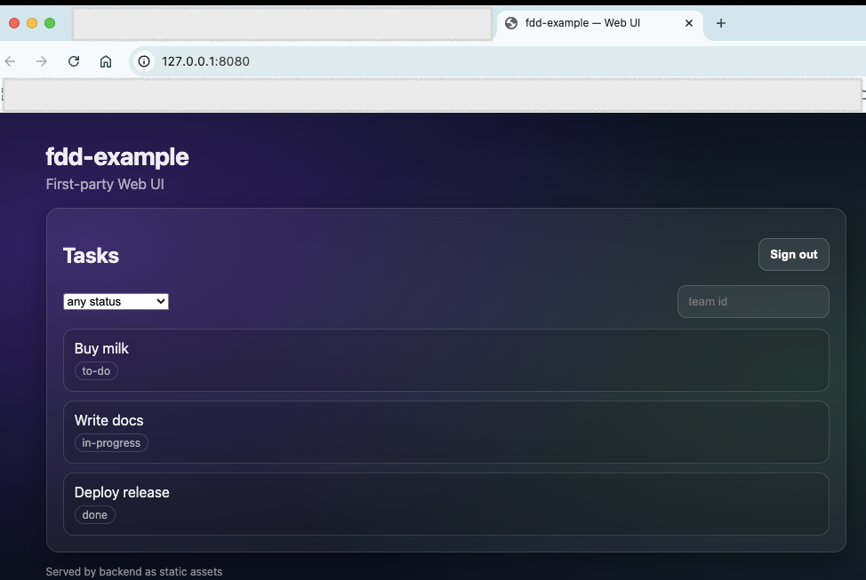
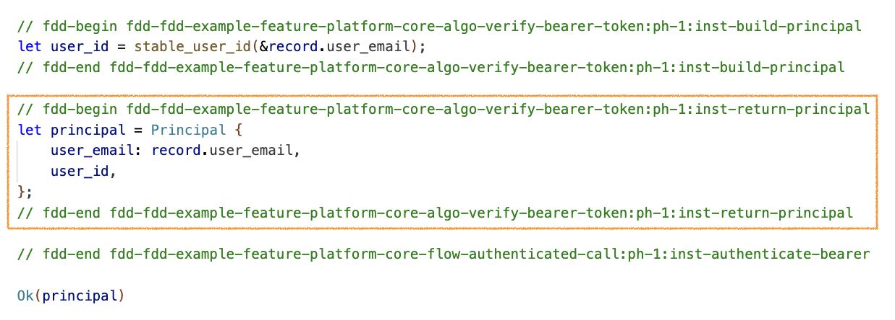
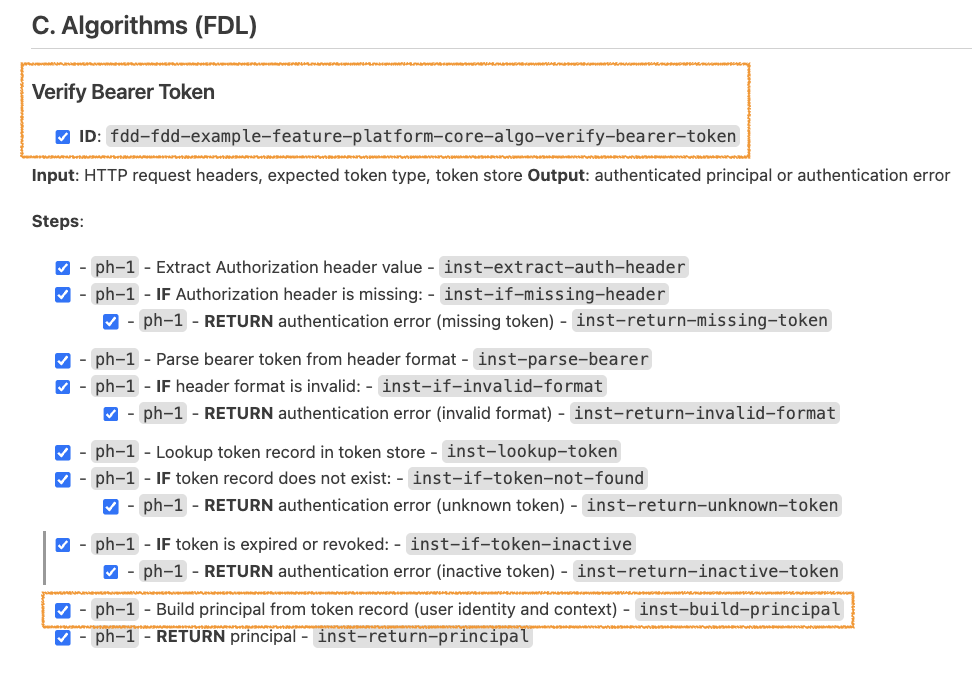

# FDD Example: Task Manager

A full-featured example project built with [FDD](https://github.com/cyberfabric/FDD). It demonstrates how FDD specifications translate into a working backend + UI with traceable code.

## What's inside

- **FDD adapter**: [`.fdd-adapter/`](.fdd-adapter/) — build/test specs, conventions, and traceability rules.
- **Architecture & documentation**:
  - [`architecture/BUSINESS.md`](architecture/BUSINESS.md) — business context
  - [`architecture/DESIGN.md`](architecture/DESIGN.md) — overall design
  - [`architecture/ADR/`](architecture/ADR/) — architecture decisions
  - [`architecture/features/FEATURES.md`](architecture/features/FEATURES.md) — feature manifest
  - Feature design docs:
    - [`feature-business-domain/DESIGN.md`](architecture/features/feature-business-domain/DESIGN.md)
    - [`feature-first-party-web-ui/DESIGN.md`](architecture/features/feature-first-party-web-ui/DESIGN.md)
    - [`feature-platform-core/DESIGN.md`](architecture/features/feature-platform-core/DESIGN.md)
- **Code**: Rust/Axum API + UI (Vite/React), tagged with FDD IDs for traceability.
  - Backend: [`src/`](src/)
  - UI: [`ui/src/`](ui/src/)
  - Tests: [`tests/`](tests/)

## Key points

- End-to-end FDD flow: from requirements and design to implementation.
- Demonstrates codegen/autogen based on FDD specs (plus traceability validation).
- Handy commands: `make build`, `make test`, `make run`, `make validate`.

## Screenshots

### **UI: Auth Page**

### **UI: Tasks Page**

### **Traceability between code and design**

### **Code: FDD Comments**

### **Design: FDL Instructions**

## Purpose

This project shows how FDD turns specs into a working product: API, UI, and tests with verified links between docs and code.
